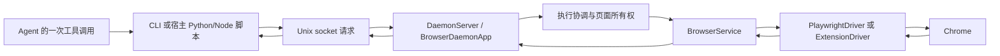

# Browser CLI 多步骤 Agent 任务调查与优化报告

日期：2026-11-05。修改前代码：`4a70d8cba68714bb5aeb1c54ebbb7b5a64025eda`。所有改动保留在工作区，未提交、推送或发布。

2026-11-06 更新：后续复审已修复本报告记录的 `scope` 与 `interactive` 组合缺口，并加强引用识别、筛选回执和部分执行状态。详见 [复审报告](browser-cli-agent-review-2026-11-06.md)。下面的基准和测试数字保留为 11 月 5 日实现的历史记录，不作为后续修正的重新测量结果。

这次选择了可选的快照响应精简、区域/角色筛选、跳转后的旧引用保护，以及取消等待的协议收尾。复用既有 Python/Node 客户端和 batch，没有新增脚本运行时、浏览器实例架构或权限。默认快照数据格式保持原样；失败响应增加类型元数据，原有错误码和退出码保留。

## 证据分级

- **代码已证实**：沿实现及已有测试可以确认的行为。
- **运行已验证**：本次在本机真实 Chrome Headless Shell、真实 Unix socket 和本地页面上执行。
- **未测/推测**：没有真实 Agent、真实站点或对应平台的数据支持，不计作性能收益。

## 1. 原有架构与能力



| 问题 | 原实现与关键位置 | 证据 |
| --- | --- | --- |
| 命令如何到浏览器 | `cli/main.py:40` 注册 parser，`actions/cli_specs.py` 定义动作及请求；`commands/action.py:14` 调 `daemon/client.py::_send_command_async`；`daemon/server.py:91` 收一个请求、执行、返回单个 JSON；`daemon/app.py:127` 协调，`:147` 分派；`daemon/browser_service.py` 选驱动，`drivers/base.py` 保持显式接口。 | 代码；本次 socket 回放验证 |
| 脚本与一次调用组合 | `task_runtime/client.py:15` 和 `task_runtime/node/client.mjs:85` 可以从普通宿主脚本调用；循环、条件判断和数据整理由 Python/Node 提供，不需要模型逐条决定，也不要求一次性任务先写任务元数据。`task_runtime/flow.py` 是已有任务辅助层。 | 代码；两种回放策略验证 |
| batch | `daemon/app.py:291` 验证 1–500 步，禁止嵌套、全局生命周期、profile 配置和 async run 管理；`:350` 顺序执行，支持停止/继续和 all/last/summary。可以包含等待、提取和普通动作；它不是分支/循环 DSL。 | 代码；原有和新增单元/集成测试 |
| 页面 JS 与宿主代码 | `eval` / `eval-on` 在网页执行，适合按选择器/ref 提取字段；宿主脚本通过客户端发送多步请求，能写循环和条件，具有原执行工具权限。二者不能混同为“页面里任意 JS 就是安全的流程运行时”。 | 代码 |
| 等待 | `browser/service.py:786` 支持文本可见/消失、精确匹配及期限；另有 network-wait、wait-network、verify-*。固定 sleep 也存在。Flow 自带有界 scroll-until-stable。普通 batch 没有总时限；自动化服务 `automation/service/runtime.py:136` 才管理整次运行 deadline。 | 代码；动态表单/分页/超时验证 |
| 快照如何生成 | Playwright 的 `browser/service.py:252` 取得 snapshotForAI 原文；扩展由 `background/page_actions.js` 取得原文。`refs/generator.py:200` 在 daemon 侧统一整理语义树和引用，`refs/registry.py:29` 保存每页最新快照。 | 代码；本次默认与精简视图回放 |
| 元素如何定位 | `refs/generator.py:138` 用 role/name/frame/occurrence 生成稳定短引用；`refs/resolver.py:173` 重建 LocatorSpec；`:97` 重建角色/文本/frame 定位。它不是 DOM marker 查找。Playwright 检查无目标/多目标，分别报 stale/ambiguous。相同语义重渲染可保留引用。 | 代码；失效定位回放 |
| 什么返回模型 | 客户端不直接控制模型上下文。默认 snapshot 返回 tree、refs_summary、捕获信息和响应 meta；每个 ref 原来还重复 page/snapshot/URL/time/selector 信息。html/eval、文件导出和 batch 模式由调用者决定返回什么。脚本可以只打印最终字段。 | 代码；响应字节实测 |
| 生命周期与归属 | `daemon/browser_service.py` 管驱动、浏览器启动与安全点重绑定；`tabs/registry.py:45` 按 X_AGENT_ID 管可见页/活动页/占用。身份隔离页面，不隔离 Cookie。`daemon/execution.py:19` 协调共享动作、全局 batch 和清理；普通并行动作仍可收到 Busy。 | 代码；既有隔离/取消测试及本次回放 |
| 取消、断连与副作用 | `daemon/app.py:516` 先确认销毁自有页面，再取消等待并拒绝迟到结果；`daemon/server.py:91` 不把 socket 断连当远端取消；`extension/session.py` 处理断连、buffer 和迟到 artifact。async read 的取消另由 `daemon/run_registry.py:85` 管理。超时/断连可能已产生副作用，不能自动重放。 | 代码；本次取消与断连验证 |

**既有性能资料**：仓库主要是功能/协议/生命周期测试，`docs/reviews/agiwo-browser-reaccept-2026-10-30.md` 有实际验收记录和个别清理耗时；daemon 有运行日志与稳定性计数，async read 有事件日志。本机 `artifacts/reaccept/20261030T051926Z-63a7de3f/` 还保存两份实际验收 JSON：integration 报告有 11 项检查和 141 条 request 记录，lifecycle 报告有 6 项检查及约 0.091 秒的取消记录，两份 `model_calls` 都是 0。它们是运行证据，不能当成真实 Agent 模型耗时/token 数据，也没有同页同配置重复样本的中位数对照。未发现可作公平前后比较的 Agent 多任务耗时/token 数据集或专用性能基准。因此先新增本地基准，不把测试数量或历史个别耗时当作性能基线。已有 `tasks/interactive_reveal_capture/task.py` 和 `tasks/lazy_scroll_capture/task.py` 也直接展示了一次宿主脚本组合动作和有界滚动的能力。

### ego(lite) 参考的核实范围

官方资料描述了通过一段 Node 代码组合浏览器函数，以及由定制 Chromium 提供语义快照。这支持“组合连续动作、只返回必要观察”的设计方向，但不证明本项目需要换浏览器或重写运行时。Browser CLI 本身已有可一次调用的宿主客户端和 batch。本次未安装、运行 ego，也未复用它宣传的真实站点性能百分比。来源：[官方产品说明](https://www.egolite.app/document/en/docs/product-introduce)、[官方仓库](https://github.com/citrolabs/ego-lite)。

## 2. 基线设计及计量边界

页面在 [tests/agent_workflow_fixture.py](../../tests/agent_workflow_fixture.py)，回放入口为 [scripts/benchmark_agent_workflows.py](../../scripts/benchmark_agent_workflows.py)。仅绑定 `127.0.0.1`；没有外部资源，CSP 禁止页面 fetch。账号通过本地 HttpOnly 模拟 Cookie 预置，输出不读取 Cookie。表单只生成本地预览，不发真实提交。

| 场景 | 固定验收条件 |
| --- | --- |
| account | 登录态下读出 fixture-user、Research、42，字段逐一相等。 |
| form | 填 Local User、选 North、等待 120ms 动态内容、点 Preview draft、读到 Local User / North。 |
| pagination | 3 页，每页 4 条，等待 90ms 更新，提取 name/price；最终 12 条完整有序且值精确相等，最后一页禁用下一页。 |
| recovery | 等延迟按钮、替换旧目标后确实收到 STALE_SNAPSHOT、重新观察、跳转账户页并确认账号内容。 |
| timeout | 已完成的前一步写入保留；150ms 文本等待失败；第三步不执行。 |
| cancel | batch 执行中关闭自有页面，确认已关闭，原请求返回结果未知；不重放。 |
| disconnect | 第一步产生本地效果后断开客户端，batch 继续，末步完成；效果恰好两次，无重复执行。 |

每页还有 80 个无关导航链接，用于暴露过度返回。固定页面 SHA-256：`a0857b364b29cc7eff8dd6653f3f42a3b832d94301564f69fa24afb0bf249fe1`。

环境：Python 3.10.20、macOS ARM64、Playwright 已安装的 Chrome Headless Shell revision 1208；独立 BROWSER_CLI_HOME 和 profile，headless、en-US、UTC，默认 1440×1024 视口。实际版本和可执行文件见各 JSON。先实际检查 LaunchServices 权限，沙箱拒绝后取得用户授权，再受审查地运行本地测试。没有尝试受限启动、换浏览器或修改 Dock/系统安全设置。

每份数据是 **7 场景 × 2 策略 × n=5 = 70 个实测样本**，每组另预热一次，共 14 个预热回放。每轮交替策略顺序。individual 使用独立动作请求；composed 只把已知连续动作换成已有 batch，分支和循环仍在同一个宿主回放函数里。两者任务数据、等待、验收一致。四种代码/视图配置分别成组顺序运行，未跨旧新版本交错；时间结果仍可能受批次负载与缓存影响，字节量比较则更直接。

计量定义：

- total_ms：从场景开始到完成验收的墙钟时间；浏览器启动、模拟登录和最终清理在计时外。
- browser_driver_ms：实际 driver 方法墙钟时间之和，含等待和状态摘要，不是浏览器 CPU 时间；取消与关闭有重叠，因此可大于任务墙钟时间。browser_action_ms 另记 daemon 分派时间。
- daemon_requests：真实 Unix socket 入口请求数；browser_actions 与 browser_driver_calls 分别记录动作数和底层调用数。
- response_bytes：实际收到的完整换行 JSON envelope 的 UTF-8 字节；断连后丢失的回包不算“收到”。final_result_bytes 是场景最终必要结果大小。
- errors 是协议返回错误计数，retries 是回放主动重试数。预期 stale/timeout/cancel 不等于验收失败。修改前另观察到取消时未消费 Playwright Future 警告，其数量未单独计量，不能混入协议错误计数作数字比较。
- **真实 Agent 工具调用、模型轮次、token、模型耗时：全部未测（null）**。原始 JSON 的 host_script_invocations=1 描述每场景一次回放边界，不是真实 Agent 工具计数或新进程数。没有用 daemon 请求数代替模型轮次。

回放经过真实 DaemonServer 和 BrowserDaemonApp，保留所有权、占用和调度路径；没有模型，没有 CLI 子进程启动成本，也没有 Node 每请求兼容性探测成本。不能将其墙钟时间当作真实 Agent 或 Node 客户端的端到端时间。

## 3. 据证据选择的修改

| 修改 | 理由、位置及边界 |
| --- | --- |
| 可选快照视图 | `refs/view.py:23` 验证配置，`:72` 从统一语义快照投影；`daemon/browser_service.py:551` 完整保存 registry 后返回视图。CLI 新增 --compact、--scope、可重复 --role、--max-lines；Python/Flow/Node 同步。默认结构不变，不加第二套 ref，不改驱动契约。 |
| 保留判断信息 | compact 保留完整树及 SnapshotResult 使用的字段，包括 nth、父引用、frame_path；角色匹配保留子树和祖先。截断只由显式 max-lines 触发，返回 counts/truncated，并在树末尾提示。筛选和截断的 refs_summary 只包含返回树的真实引用；页面名字里的伪造 [ref=...] 不能成为范围定位依据。 |
| 旧 daemon 不静默忽略选项 | Python `daemon/client.py:125` 和 Node 客户端检查请求视图的回包标记；缺失时提示升级/reload，绝不重放。检查 batch 中实际保留的快照结果；result-mode 丢弃的成功结果保持原约定。兼容错误不把未筛选的树塞回错误摘要。 |
| 跳转后引用保护 | `daemon/browser_service.py:1023` 在 ref 动作前核对捕获 URL；变化时使用现有 STALE_SNAPSHOT，增加 failure_kind=page_changed。单个尚未开始的动作标 not_started；fill-form 前面字段已填时仍标 unknown，避免把部分动作误判为整步未开始。代价是 ref 动作多一次页面摘要查询。 |
| 可识别错误元数据 | `daemon/app.py:240` 增加 failure_kind，保留已有错误码；原来落入 INTERNAL_ERROR 的后端 TimeoutError 增加 timeout。未知引用、失效、多目标、页面不可访问、断连/取消可按已有代码和新增类别判断。TAB_NOT_FOUND 仍不区分无权访问与不存在。没有承诺所有后端权限/超时错误都已统一分类。 |
| 取消等待收尾 | `browser/service.py:807` 仅对 wait 的文本/固定时长观察保留并消费协议回包；页面关闭后的迟到异常不再成为未消费 Future。没有重放，也没有把该逻辑扩到变更动作、其他等待接口或改变关闭确认顺序。 |
| 使用指引与打包 | 新 [多步骤使用指南](../agent-workflows-zh.md)，更新 README 和两个 skill 及其打包副本；说明组合/观察/用户授权边界、失败进度、脚本权限、时限和日志。更新 AGENTS、守卫、MANIFEST 与源码包一致性测试。 |

### 未采用的方案

不新建代码执行 RPC、守护进程 Python/JS 沙箱或分支 DSL：宿主客户端已有这些组合能力，新增执行权限/终止模型缺少收益证据。不把所有流程塞进页面 eval：它有页面权限，不能替代 daemon 所有权和取消控制。不修改 Chromium 或重做 driver/ref 架构。不默认改变快照格式，不缓存整个观察冒充新鲜页面，不自动重试写操作，不绕过用户确认。不重构调度器，也不引入全局 batch 总超时，因为这会改变现有断连/取消语义。

## 4. 同条件结果

数据文件位于 [benchmarks/agent-workflows-2026-11-05](../benchmarks/agent-workflows-2026-11-05)。before.json 在产品代码修改之前运行；default-after.json 是修改后的默认视图兼容性对照；compact-after.json 只开 compact；focused-after.json 再筛选 main。**不能把当前版本的默认回放冒充旧版本基线。** 下表由原始样本的各组中位数生成。

四份数据均为 **70/70 验收通过**（每场景/策略 n=5），总计 280 个测量回放，另有 56 个预热回放。超时/取消等场景的“通过”指预期失败和收尾条件得到验证，不是把失败动作算作业务成功。

下表使用 composed 策略，单位为完整响应 **字节**。这部分比较保持动作和验收一致，只改变可选观察方式。

| 场景 | 修改前 | 修改后默认 | 仅 compact | compact + main | 相比修改前减少 |
| --- | ---: | ---: | ---: | ---: | ---: |
| account | 47,256 | 47,256 | 20,643 | 2,605 | 94.5% |
| form | 48,658 | 48,658 | 21,479 | 3,444 | 92.9% |
| pagination | 54,704 | 54,704 | 24,918 | 6,882 | 87.4% |
| recovery | 141,972 | 142,006 | 62,080 | 7,968 | 94.4% |
| timeout | 6,615 | 6,935 | 6,935 | 6,935 | -4.8% |
| cancel | 1,039 | 1,039 | 1,039 | 1,039 | 0.0% |
| disconnect | 614 | 614 | 614 | 614 | 0.0% |

四个有快照的场景，仅 compact 的响应减少约 **54%–56%**；加上已知 main 区域筛选后减少 **87.4%–94.5%**。默认视图的成功响应大小保持一致。故障信息没有全部变小：timeout 因等待收尾栈及类型元数据由 6,615 增到 6,935 字节。cancel/disconnect 没有快照，体积不变。

最终必要业务结果分别为 account 62、form 20、pagination 396、recovery 60 字节，四种配置完全相同。**如果宿主脚本原本就只把这些字段交给模型，本次没有进一步缩小该模型边界的结果。响应体积下降不等于 token 或模型轮次下降。**

任务墙钟时间中位数，单位 ms：

| 场景 | 修改前 | 修改后默认 | 仅 compact | compact + main |
| --- | ---: | ---: | ---: | ---: |
| account | 28.4 | 27.8 | 30.3 | 28.0 |
| form | 252.1 | 246.1 | 252.8 | 249.4 |
| pagination | 445.3 | 447.3 | 446.1 | 441.1 |
| recovery | 302.6 | 305.6 | 306.2 | 300.9 |
| timeout | 169.7 | 169.7 | 170.5 | 169.9 |
| cancel | 46.3 | 46.0 | 45.8 | 46.7 |
| disconnect | 327.1 | 324.5 | 325.1 | 326.1 |

浏览器 driver 耗时和实际调用量如下（before → focused-after）。动作数为 handler 级浏览器动作；底层方法数包括摘要查询。

| 场景 | driver 耗时 ms | 浏览器动作数 | driver 方法调用数 | 入口请求数 |
| --- | ---: | ---: | ---: | ---: |
| account | 24.9 → 24.6 | 3 → 3 | 5 → 5 | 3 → 3 |
| form | 248.1 → 245.5 | 7 → 7 | 13 → 16 | 3 → 3 |
| pagination | 439.9 → 435.9 | 9 → 9 | 17 → 19 | 7 → 7 |
| recovery | 294.3 → 293.5 | 10 → 10 | 18 → 22 | 9 → 9 |
| timeout | 167.4 → 167.7 | 4 → 4 | 6 → 6 | 3 → 3 |
| cancel | 72.1 → 72.9 | 4 → 4 | 5 → 5 | 3 → 3 |
| disconnect | 324.4 → 323.5 | 5 → 5 | 9 → 9 | 3 → 3 |

新 URL 防护使 form/list/recovery 的 driver 查询分别多 3/2/4 次；没有增加浏览器变更动作或 daemon 入口请求。耗时有小幅上下波动，仅 compact 的若干场景反而略慢，n=5 也不足以作稳定加速判断。**本轮没有证实任务总耗时或浏览器执行耗时稳定提升。**

既有 batch 的对照：form 的 independent 请求为 7 次、composed 为 3 次；pagination 为 9 → 7；recovery 为 10 → 9。修改前已经如此，修改后没有进一步减少。这些请求减少不能归为本次新增收益，更不能当成模型轮次减少。两种策略均可装在一次宿主工具调用中。这里的 composed 只是合并已知连续段，并不是已有客户端的最优请求数上限。

为隔离视图效果，前后刻意保留相同的快照观察；这不是要求生产脚本每次都观察。已验证的只读字段提取可直接用原有 eval 或一次 batch，省去不必要快照；这同样是原有能力。

每份数据的全部 70 个回放均主动重试 0 次；协议预期错误均为 STALE_SNAPSHOT 10、INTERNAL_ERROR 10、OPERATION_CANCELLED 10。after 的 timeout 另有 failure_kind=timeout。三份 after 日志未检出未消费 Future 或销毁中 Task 警告；这是一项日志核查，不是原始 before 警告数量的定量改善。真实 Agent 工具次数、模型轮次、token、模型耗时仍全部未测。

原始数据：[修改前](../benchmarks/agent-workflows-2026-11-05/before.json)、[修改后默认](../benchmarks/agent-workflows-2026-11-05/default-after.json)、[仅精简](../benchmarks/agent-workflows-2026-11-05/compact-after.json)、[精简与 main 筛选](../benchmarks/agent-workflows-2026-11-05/focused-after.json)。

## 5. 验证、复现与限制

复现时先检查 `browser-cli status --json`。独立浏览器测试需要实际宿主启动权限；本次已按用户授权在沙箱外运行。源码工作区先刷新 editable 安装：

```bash
uv sync --dev --reinstall-package browser-control-and-automation-cli
uv run python -m scripts.benchmark_agent_workflows --samples 5 --warmups 1 --output /tmp/before.json
# 以上应在旧版本执行并保存；修改后保持页面和配置不变：
uv run python -m scripts.benchmark_agent_workflows --samples 5 --warmups 1 --output /tmp/default-after.json
uv run python -m scripts.benchmark_agent_workflows --compact --samples 5 --warmups 1 --output /tmp/compact-after.json
uv run python -m scripts.benchmark_agent_workflows --compact --focus-main --samples 5 --warmups 1 --output /tmp/focused-after.json
uv build --no-sources
./scripts/check.sh
```

这里是本地验证构建，未发布。完整检查最初因现有 dist 源码包包含修改前测试而失败，重新构建后再验证。不能将第一次失败算作通过。

最终 `./scripts/check.sh` 退出 **0**：

- Python：**512 passed**，102.76 秒，包含 44 个新增本地工作流集成用例。
- Node 与扩展 JS：**57 passed，0 failed，0 skipped**，包括 18 个 Node 客户端用例。
- compileall、Python 3.10 compatibility guard、ruff check/format、JS syntax、架构/产品/文档守卫：全部通过。
- `uv build --no-sources`：成功生成本地 wheel 和 sdist；源码包一致性检查通过。
- 四份正式基准：每份 70/70，页面哈希一致，样本量和验收一致；所有回放重试 0 次。
- `git diff --check`：通过。没有提交、推送、发布，也没有操作真实账号。

完整检查日志：`/private/tmp/browser-cli-check-final.log`；本地构建日志：`/private/tmp/browser-cli-build.log`；修改后三份基准日志：`/private/tmp/browser-cli-{default,compact,focused}-after.log`。运行日志只包含本地模拟数据。

新增测试覆盖：相同任务在三种观察方式与两种策略下的成功/预期失败；超时后停止与已有副作用；取消、断连后继续且不重放；同名元素跨 URL 的旧引用；范围/角色/截断元数据；伪造 ref 文本；完整 registry 与可操作 ref；默认 Python/Node 请求兼容；旧 daemon 拒绝视图；错误码兼容；fill-form 部分执行状态；只读等待迟到异常；源码包包含基准和测试资产。既有驱动、归属、并发、批处理、扩展传输及隔离测试继续执行。

已知限制与下一步：

1. 没有真实 Agent、真实账号或真实站点的收益数据。下一步应用同一模型、同一 Agent harness、相同任务与验收，记录真实工具边界、模型轮次/token/耗时，并重复运行。只有那时才能判断 skill 引导和响应缩小是否减少模型往返。
2. 本次浏览器性能只在 macOS Headless Shell 测量。扩展视图共享 daemon 投影并有双驱动 stub 测试，但未实测真实 Chrome 扩展的性能；Windows/Linux、跨域 iframe、shadow DOM、大页面和真实网站权限弹窗未覆盖。既有扩展测试通过不能替代这些真实验收。
3. 新视图在完整采集/语义生成后投影，主要减少 daemon 到客户端的返回；不减少扩展到 daemon 的原始快照，也不提高 32 MiB 传输限制。若采集本身很慢或原始帧过大，下一步分段计时驱动采集、生成、投影和编码，再决定是否值得扩展驱动契约。
4. 当前 --no-full-page 在两条采集路径均未实际做视口裁剪；保留接口并在指南说明，未把它当优化。scope 与 --interactive 混用时，非交互范围引用可能先被该模式省略；需要区域范围时使用完整模式和角色筛选。
5. URL 防护不能证明同 URL 重载后的文档身份，也不能消除检查与点击间的导航竞态或所有同名定位歧义。真实提交仍需新鲜观察和业务授权。
6. 普通 batch 和一次性 Python 脚本没有新增总 deadline；取消宿主脚本不等于远端取消。自动化服务原有总时限、Node 逐请求超时、owner-scoped close 保持现状。长期独占 batch 仍会阻塞其他浏览器动作，应分成短段。
7. 快照精简不是秘密脱敏器，也不是权限隔离；页面数据仍不可信。没有新增对 Cookie、令牌或敏感表单的日志记录。真实账号安全及不可逆业务动作不在这套本地基准范围内。

本轮可证实的目标是减少无关返回并加强可预测执行。即使数据量明显降低，也不能据此宣布浏览器动作、模型推理或整个 Agent 任务等比例加速。
